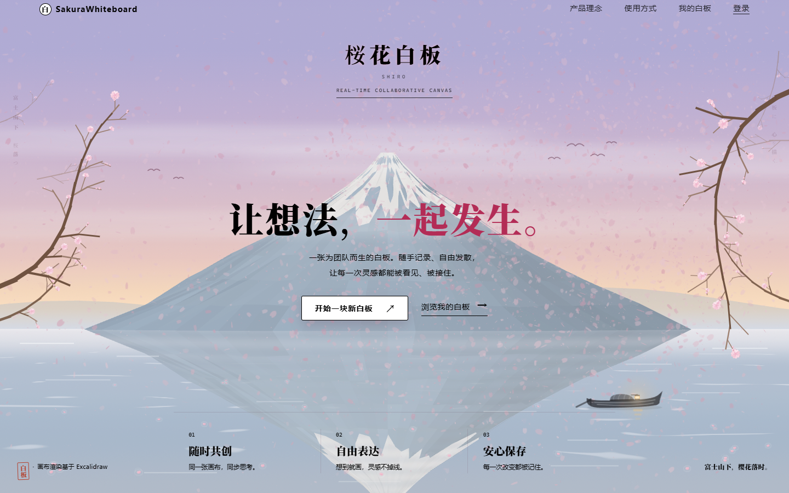
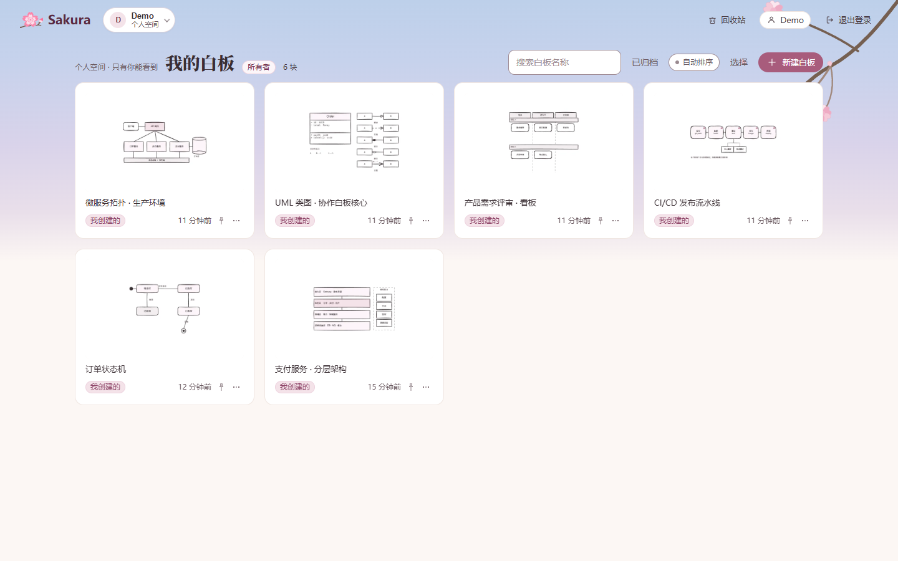
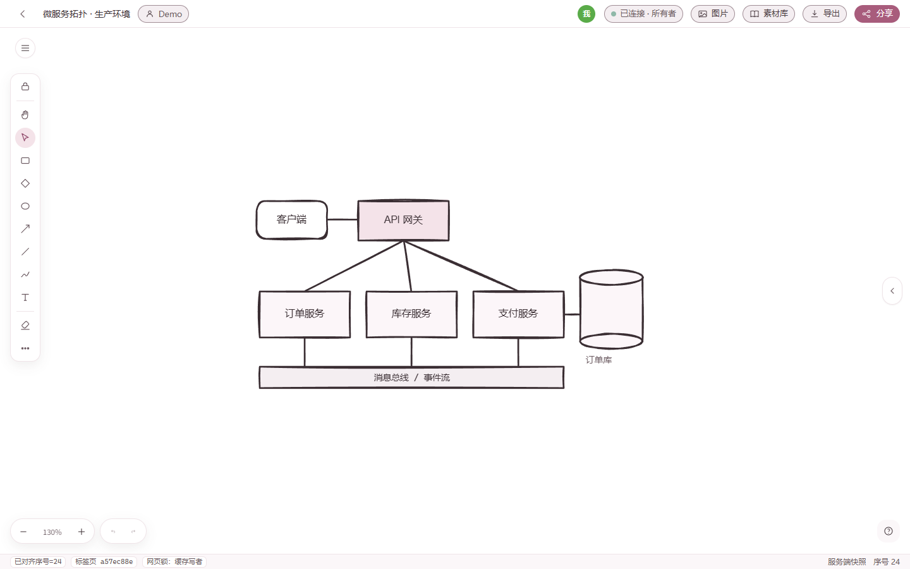
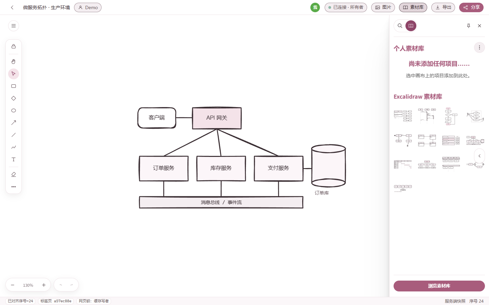
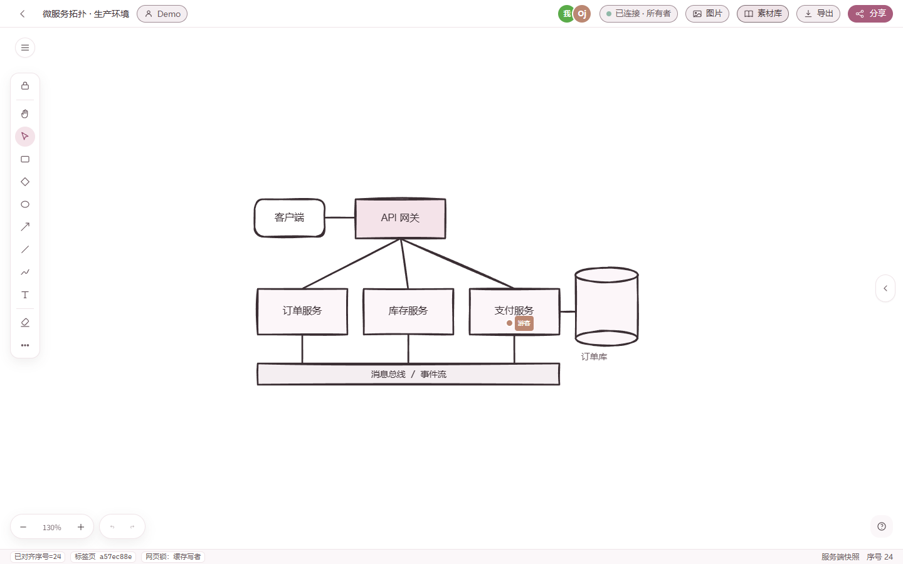
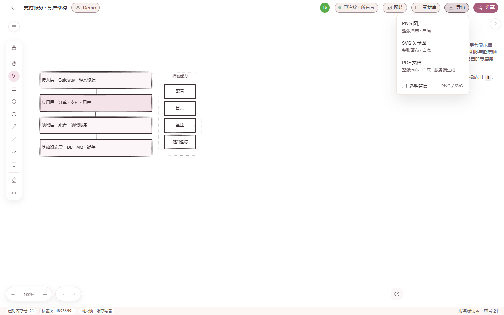
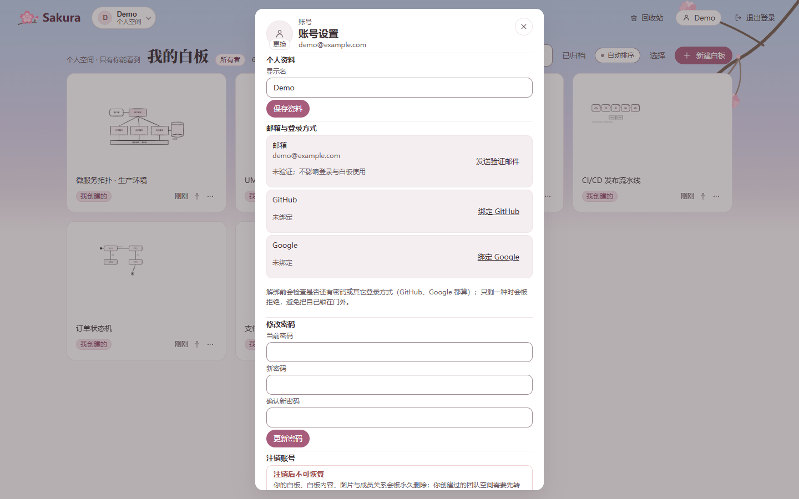
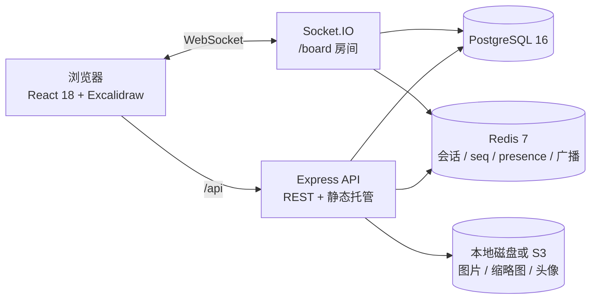

# 桜花白板 · SakuraWhiteboard

一个可以多人同时在线的无限画布白板。前端基于 Excalidraw 渲染，协作链路（操作同步、身份与权限、分享、图片资产）由项目自己实现，不依赖第三方协作服务，因此可以整套私有化部署。

它解决的问题是：团队既想要一块「打开就能画」的白板，又需要真正的权限、分享、归档、回收站和可审计的存储——而不是一个谁拿到链接都能改、数据留在别处的在线画板。围绕这一点，仓库把「实时协作」这条链路端到端做通，并内置了一套工程图素材库（分层架构、状态机、CI/CD、看板、UML、微服务拓扑等）。



## 界面一览

| 我的白板 | 编辑器 |
|---|---|
|  |  |

**编辑器**：左侧竖排工具栏、顶部状态条（在线协作者、连接状态、图片、素材库、导出、分享）与可折叠的右侧属性面板（截图中已收起）；画布内容为素材库中的「微服务拓扑」模板。

**素材库 · 工程图模板**



内置 13 条工程图模板，首次打开时自动种入浏览器本地素材库，之后不会覆盖用户自己的增删。

**多人协作**：在线协作者头像与远程光标实时可见。



**导出**：PNG / SVG 在浏览器本地生成（可选透明背景），PDF 由服务端封装。



**账号设置**：邮箱与登录方式、GitHub / Google 绑定与解绑、修改密码、注销账号。



## 已实现的能力

### 画布与绘图

- 基于 Excalidraw 0.18 的无限画布：图形、箭头、文本、图片、嵌入卡片，撤销重做、框选、缩放与吸附。
- 画布改动先在前端 diff 成元素级 op，50ms 静默合并后提交；本地交互不因远端更新而被打断。
- 多标签页写者选举（Web Locks），同一块板不会因为开了两个标签页而互相覆盖。

### 素材库与工程图模板

- 13 条 P0 工程图模板：分层架构、微服务拓扑、状态机、CI/CD 流水线、看板、UML 类图等。
- 模板以 Excalidraw 原生库条目形式写入 `localStorage`，可直接拖到画布；个人素材库与内置素材库分栏展示。
- 提供「恢复默认模板」，只补回缺失条目，不复活用户主动删掉的模板。

### 多人实时协作

- Socket.IO 房间广播 + Redis Adapter，多实例之间也能互相同步。
- op 先落库再广播，`seq` 单调递增；断线重连按 `since` 补拉，跨度超过阈值时回落到整板快照。
- 冲突按 `version` + `versionNonce` 的 LWW 规则收敛。
- presence（在线成员）与光标位置实时同步，跨实例聚合；Redis 不可用时降级为进程内视图，仅影响在线展示。

### 分享与权限

- 分享链接支持「只读 / 可编辑」两种权限，可设置过期时间、随时吊销，也可直接改权限；吊销立即生效。
- 链接 token 只以哈希形式入库，通过 URL fragment 传给前端。
- 只读成员可以申请编辑权限，板主批准后写入成员表；任何可读白板都能「存为副本」到自己的空间（含图片资产）。

### 白板管理

- 我的白板：置顶、手动拖拽排序（按用户保存，可切回时间序）、搜索、归档、右键菜单、批量选择。
- 回收站：删除进入 30 天回收站，可还原或彻底删除。
- 缩略图：离开白板时客户端生成并上传，列表用带内容哈希的地址展示，换设备后可从服务端取回。
- 快照：协作同步跨度较大时整板快照下发，保证长时间离线后打开仍是完整场景。

### 导出

- PNG / SVG 在浏览器本地生成，可导出整张画布或透明背景。
- PDF 由服务端封装（仅板 owner，A4 横向白底）。

### 账号体系

- 邮箱 + 密码注册登录（argon2id 哈希，Redis 会话 + HttpOnly Cookie）。
- GitHub / Google OAuth 登录，登录后可在账号设置里绑定与解绑；未配置的应用不显示入口。
- 找回密码、邮箱验证、登录态修改密码、注销账号；令牌一次性、24 小时有效。
- 游客可直接使用：签名 `wb_gid` Cookie 标识身份，未登录时统一落到公共临时板；注册后可把历史游客板认领到账号下。

### 空间与成员

- 团队空间：`owner / editor / viewer` 三级角色，支持创建空间、7 天邀请链接、加入空间。
- 空间是白板权限的唯一来源；分享链接与空间成员都通过同一套访问判定推导权限。

### 存储与运维任务

- 图片：粘贴、拖入、工具栏选图三条入口；单张 ≤5MB、单板 ≤50MB，仅收 PNG/JPEG/WebP/GIF；服务端按魔数校验真实格式与尺寸，同板同哈希秒传。
- 存储驱动：本地磁盘或 S3 兼容对象存储（图片、缩略图、头像统一走同一驱动）；读取走短时签名 URL。
- 定时任务（Asia/Shanghai）：回收站清理 03:00、游客板清理 03:10、资产 GC 03:20；多副本用 PostgreSQL advisory lock + 任务账本按自然日去重。
- 资产对账：`storage:audit` 只出报告，区分「库有引用但对象缺失」与「对象存在但无引用」。

## 技术栈与架构

- 前端：Vite 7 + React 18 + TypeScript + Excalidraw 0.18，Socket.IO 客户端。
- 后端：Express 4 + TypeScript，Socket.IO 服务端，PostgreSQL 16，Redis 7，S3 SDK，pdf-lib，nodemailer。
- 部署：npm workspaces 单仓，Docker Compose 起 PostgreSQL / Redis / API（前端构建产物由 API 同源托管）。



一次编辑的路径：画布 `onChange` → diff 成 op → 50ms 批合并 → `op:submit` → 服务端校验、落库、分配 `seq` → `op:apply` 广播 → 对端回放（不抢本地焦点）。

## 快速开始

### 依赖

- Node.js 20+（CI 使用 Node 22）与 npm（使用 workspaces）
- Docker（跑 PostgreSQL 16 与 Redis 7，或直接用本机实例）

### 本地开发

```bash
npm install
cp .env.example .env          # Windows PowerShell: Copy-Item .env.example .env
```

`.env` 里至少确认这几项：`DATABASE_URL`、`REDIS_URL`、`SESSION_SECRET`、`GUEST_COOKIE_SECRET`（≥32 字节）。OAuth 与 SMTP 不填也能启动，对应入口会自动隐藏 / 邮件落到日志。

```bash
docker compose -f deploy/docker-compose.yml up -d postgres redis   # 只起数据库与缓存
npm run migrate                                                    # 建表，幂等
npm run dev                                                        # API :8080 + Vite :5173
```

打开 <http://127.0.0.1:5173>。Vite 已把 `/api`、`/socket.io` 代理到 `127.0.0.1:8080`，开发时只访问 5173。

### 容器方式

```bash
docker compose -f deploy/docker-compose.yml up -d --build
```

打开 <http://localhost:8080>。镜像内会先跑迁移，再由 API 同源托管前端构建产物；改代码后需要 `--build` 重建。

### 常用命令

```bash
npm run dev         # 单终端同时起前端 HMR(5173) 与后端 watch(8080)
npm run dev:server  # 只起后端
npm run dev:web     # 只起前端
npm run migrate     # 执行数据库迁移（幂等）
npm test            # server + web 单元测试（vitest）
npm run e2e         # 浏览器端到端测试（服务没起会自动拉起）
npm run typecheck   # shared 构建后对 server / web 做 tsc 检查
npm run build       # shared → server → web 构建
```

运维任务（默认 dry-run，`--apply --yes` 才真正执行）：

```bash
npm run trash:gc -w @whiteboard/server
npm run guest:gc -w @whiteboard/server
npm run asset:gc -w @whiteboard/server -- --grace-hours=24
npm run storage:audit -w @whiteboard/server -- --driver=local
```

## 目录结构

```
apps/
  web/                前端：页面、Excalidraw 画布、协作管线、素材库、缓存与自绘 UI
  server/             后端：REST、Socket.IO、权限、图片资产、迁移与运维任务
packages/
  shared/             前后端共享：协议类型、op schema、错误码、角色与限额
deploy/
  docker-compose.yml  PostgreSQL / Redis / API / 自动迁移
test/                 浏览器端到端测试用例与运行器
docs/
  images/             README 截图
  实时协作白板_开发文档.md   开发文档（接口契约、数据模型、决策记录）
```

## 已知边界与未实现

- 生产对象存储只在本地 `rclone serve s3` 上联调过，云厂商桶尚未实机验证；本地磁盘驱动是验收最完整的路径。
- 资产 GC 默认只出报告，调度真正回收需要 `ASSET_GC_APPLY=true` 且 `NODE_ENV=production`。
- 导出只支持 PNG / SVG（客户端生成）与 PDF（服务端封装，A4 横向白底）；没有服务端 PNG / SVG 渲染与矢量 PDF。
- 实时同步走 WebSocket（Socket.IO），没有 SSE 接口。
- OAuth 只支持 GitHub 与 Google，其它 provider 未实现。
- 未配置 SMTP 时，找回密码 / 邮箱验证的链接写进服务端日志，适合本地开发，上线需配置真实 SMTP。
- 游客板不可恢复：登录用户删除进 30 天回收站，游客板删除是物理删除；公共临时板只能用 `POST /api/public-board/reset` 清空。
- 生命周期任务运行在 API 进程内，多副本靠 PostgreSQL advisory lock 去重，没有独立任务队列。
- 图片限额（单张 5MB / 单板 50MB）是 `packages/shared` 中的常量，暂不可配置。
- 移动端窄屏下 Excalidraw 工具岛约有 20px 裁切，未修复。
- `last_edited_at` 采用 5s 合并回写，列表「最近编辑」最多延迟约 5 秒。

## 文档索引

- [开发文档](docs/实时协作白板_开发文档.md)（v1.13）：定位与范围、核心机制、数据模型、权限、接口、页面组件、里程碑、未实现清单与决策记录。
- [视觉方案](docs/视觉方案.md)：首页与配色方向的早期设计稿，部分已落地，仅作历史参考。
- [.env.example](.env.example)：全部环境变量与注释。
- [test/](test/)：端到端用例（容量、白板列表、拖拽、缩略图、主题、权限、编辑器、回收站、改名、登出、认领、账号、OAuth、导出）。
- [.github/workflows/ci.yml](.github/workflows/ci.yml)：typecheck / test / build 三个独立 job。

## License

MIT
